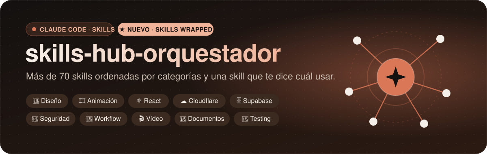
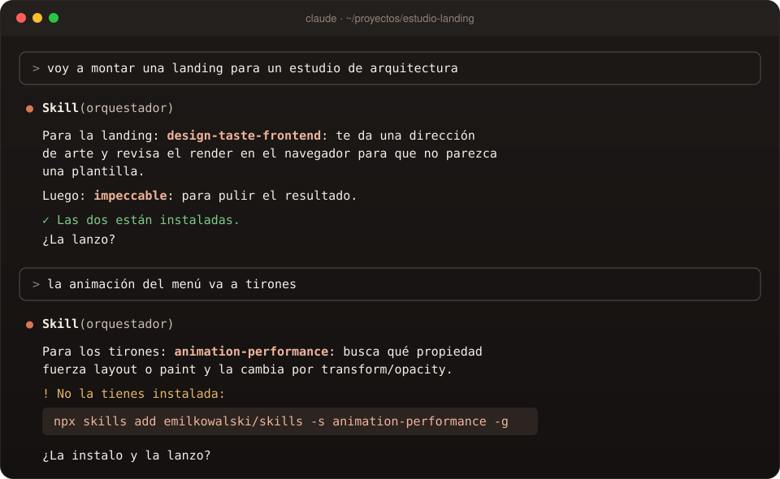
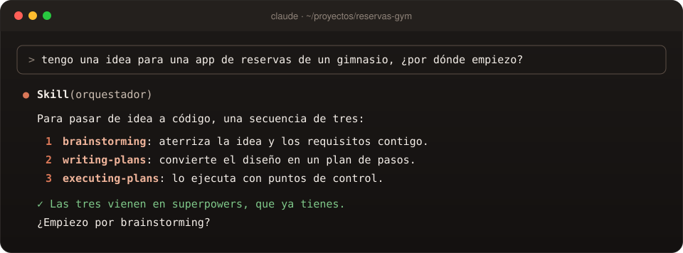
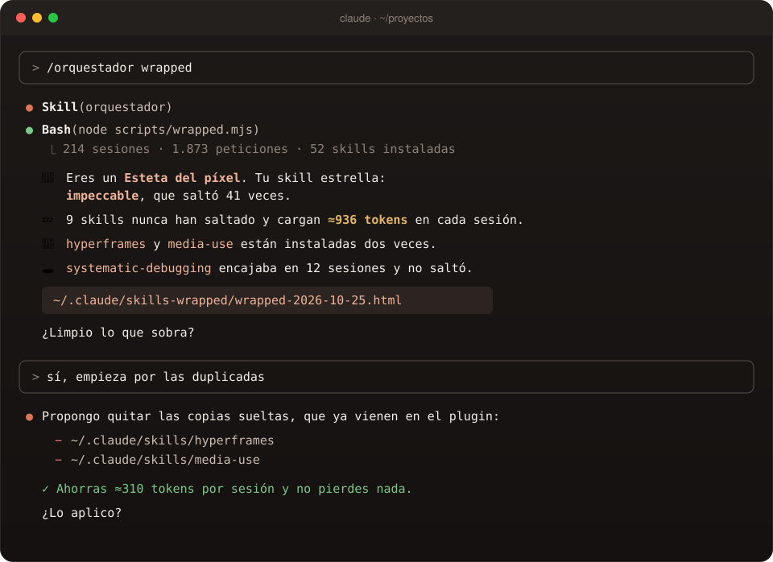
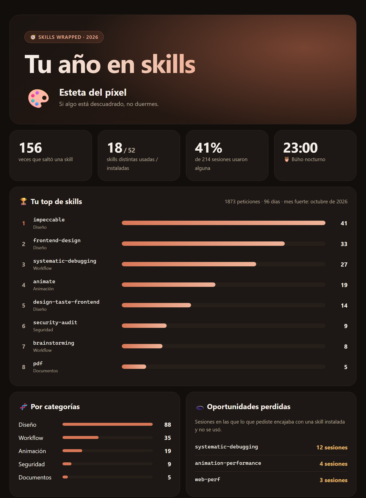

<div align="center">



<br>

**El catálogo de skills de Claude Code que uso a diario, ordenado por categorías,<br>una skill que, según lo que vayas a hacer, te dice cuál usar<br>y 🎵 Skills Wrapped: el informe de cómo las usas de verdad.**

<br>

[](LICENSE)
[](https://docs.claude.com/en/docs/claude-code/plugin-marketplaces)
[](#catalogo)
[](#catalogo)
[](#wrapped)
[](https://github.com/envyx10/skills-hub-orquestador/stargazers)

<br>

<a href="#instalacion"><b>Instalación</b></a> &nbsp;•&nbsp;
<a href="#como-funciona"><b>Cómo funciona</b></a> &nbsp;•&nbsp;
<a href="#wrapped"><b>Skills Wrapped</b></a> &nbsp;•&nbsp;
<a href="#catalogo"><b>Catálogo</b></a> &nbsp;•&nbsp;
<a href="#creditos"><b>Créditos</b></a> &nbsp;•&nbsp;
<a href="#english"><b>English</b></a>

</div>

<br>

## 💡 Qué es

Hay cientos de skills para Claude repartidas por GitHub. Saber cuáles existen, cuáles merecen la
pena, cuál aplicar en cada momento y cuáles te sobran lleva tiempo. Este repo lo resuelve así:

<table>
<tr>
<td width="225" valign="top" align="center"><br><b>🧭&nbsp; Elige por ti</b><br><br><sub>La skill <code>orquestador</code> lee tu tarea, mira qué tienes instalado y te recomienda la skill adecuada, o una secuencia corta, explicando por qué.</sub><br><br></td>
<td width="225" valign="top" align="center"><br><b>📚&nbsp; Catálogo curado</b><br><br><sub>Más de <b>70 skills</b> probadas en proyectos reales, en <b>10 categorías</b>, con para qué sirve cada una, cuándo usarla y cuándo no.</sub><br><br></td>
<td width="225" valign="top" align="center"><br><b>🎵&nbsp; Skills Wrapped</b><br><br><sub>Tu historial convertido en informe: tu top, las que <b>nunca usas y te gastan contexto</b>, las duplicadas y las que se te escaparon.</sub><br><br></td>
<td width="225" valign="top" align="center"><br><b>🔗&nbsp; Siempre del original</b><br><br><sub>No se copia nada ajeno: cada skill se instala <b>desde el repo de su autor</b>, con el comando exacto.</sub><br><br></td>
</tr>
</table>

<br>

<div align="center">

<br>
<sub><i>Así responde el orquestador: recomienda, explica y, si falta algo, te da el comando.</i></sub>
</div>

<br>

<a id="instalacion"></a>
## 📦 Instalación

Dos líneas dentro de Claude Code:

```text
/plugin marketplace add envyx10/skills-hub-orquestador
/plugin install orquestador@skills-hub-orquestador
```

Las skills del catálogo se instalan cada una desde su repo. Por ejemplo:

```bash
npx skills add emilkowalski/skills -s animate -g
```

> [!TIP]
> No hace falta instalarlas todas de golpe. Instala el orquestador y deja que te diga qué te falta
> a medida que lo necesites.

<a id="como-funciona"></a>
## ⚙️ Cómo funciona

<table>
<tr>
<td align="center" width="225" valign="top"><h3>1️⃣</h3><b>Describes la tarea</b><br><sub>«quiero animar un modal»</sub></td>
<td align="center" width="225" valign="top"><h3>2️⃣</h3><b>Mira tu sesión</b><br><sub>qué skills tienes instaladas</sub></td>
<td align="center" width="225" valign="top"><h3>3️⃣</h3><b>Busca en el catálogo</b><br><sub>tabla rápida + detalle por skill</sub></td>
<td align="center" width="225" valign="top"><h3>4️⃣</h3><b>Recomienda y lanza</b><br><sub>o te da el comando si falta</sub></td>
</tr>
</table>

Prueba con cosas como:

<table>
<tr><th width="340" align="left">Tú dices…</th><th width="560" align="left">El orquestador propone</th></tr>
<tr><td><i>«Voy a montar una landing para un estudio de arquitectura»</i></td><td><code>design-taste-frontend</code> → <code>impeccable</code></td></tr>
<tr><td><i>«La animación del menú va a tirones»</i></td><td><code>animation-performance</code></td></tr>
<tr><td><i>«Audita la seguridad de esta API»</i></td><td><code>security-audit</code></td></tr>
<tr><td><i>«Tengo una idea pero no sé por dónde empezar»</i></td><td><code>brainstorming</code> → <code>writing-plans</code> → <code>executing-plans</code></td></tr>
<tr><td><i>«Hazme un vídeo promo de mi web»</i></td><td><code>hyperframes</code> → <code>product-launch-video</code></td></tr>
<tr><td><i>«Este test falla y no sé por qué»</i></td><td><code>systematic-debugging</code></td></tr>
<tr><td><i>«¿Qué skills me sobran?»</i></td><td><code>/orquestador wrapped</code> 🎵</td></tr>
</table>

Cuando la tarea es grande, no te da una skill suelta sino **la secuencia en orden**:

<div align="center">

<br>
<sub><i>De idea a código en tres pasos, y te avisa de que ya tienes las tres instaladas.</i></sub>
</div>

<a id="wrapped"></a>
## 🎵 Skills Wrapped

**El Spotify Wrapped de tus skills.** El orquestador lee tu historial de Claude Code y te dice la
verdad sobre cómo las usas:

<table>
<tr>
<td width="225" valign="top" align="center"><br><b>🏆 Tu top</b><br><br><sub>Las skills que más saltan, por categoría, y tu perfil: ¿esteta del píxel, metódico, paranoico profesional?</sub><br><br></td>
<td width="225" valign="top" align="center"><br><b>💤 Las que sobran</b><br><br><sub>Instaladas que nunca han saltado y los <b>tokens de contexto</b> que te cuestan en cada sesión.</sub><br><br></td>
<td width="225" valign="top" align="center"><br><b>👯 Duplicadas</b><br><br><sub>La misma skill instalada dos veces, como skill suelta y dentro de un plugin.</sub><br><br></td>
<td width="225" valign="top" align="center"><br><b>🕳️ Oportunidades perdidas</b><br><br><sub>Veces en que lo que pediste encajaba con una skill que tenías y no se usó.</sub><br><br></td>
</tr>
</table>

#### 1. Lo pides

```text
/orquestador wrapped
```

El orquestador analiza tu historial, te lo cuenta en cuatro líneas y te propone limpiar. No toca
nada hasta que le dices que sí:

<div align="center">

<br>
<sub><i>Resumen en el chat y propuesta de limpieza, con el ahorro de tokens calculado.</i></sub>
</div>

#### 2. Te llega el informe

Un HTML con tu año en skills, listo para abrir en el navegador y compartir:

<div align="center">

<br>
<sub><i>Informe de ejemplo. El tuyo se genera en local en <code>~/.claude/skills-wrapped/</code>.</i></sub>
</div>

#### Opciones

<table>
<tr><th width="340" align="left">Opción</th><th width="560" align="left">Para qué</th></tr>
<tr><td><code>--since 2026-01-01</code></td><td>Analizar solo desde una fecha</td></tr>
<tr><td><code>--projects</code></td><td>Mostrar los nombres de tus proyectos en el HTML (por defecto no salen)</td></tr>
<tr><td><code>--out &lt;carpeta&gt;</code></td><td>Guardar el informe en otra carpeta</td></tr>
<tr><td><code>--demo</code></td><td>Generar un informe con datos de ejemplo, sin leer tu historial</td></tr>
</table>

> [!NOTE]
> **Todo ocurre en tu máquina.** El script ([`wrapped.mjs`](plugins/orquestador/skills/orquestador/scripts/wrapped.mjs),
> Node sin dependencias) lee `~/.claude/projects` y no envía nada a ningún sitio. El HTML no
> incluye tus prompts ni los nombres de tus proyectos, así que puedes compartirlo sin miedo.

<a id="catalogo"></a>
## 📚 Catálogo

<div align="center">
<table>
<tr>
<td align="center" width="180" valign="top"><a href="#cat-diseno"><h3>🎨</h3><b>Diseño</b></a><br><sub>12 skills</sub></td>
<td align="center" width="180" valign="top"><a href="#cat-animacion"><h3>🎞️</h3><b>Animación</b></a><br><sub>7 skills</sub></td>
<td align="center" width="180" valign="top"><a href="#cat-react"><h3>⚛️</h3><b>React y Next</b></a><br><sub>3 skills</sub></td>
<td align="center" width="180" valign="top"><a href="#cat-cloudflare"><h3>☁️</h3><b>Cloudflare</b></a><br><sub>4 skills</sub></td>
<td align="center" width="180" valign="top"><a href="#cat-backend"><h3>🗄️</h3><b>Backend</b></a><br><sub>3 skills</sub></td>
</tr>
<tr>
<td align="center" valign="top"><a href="#cat-seguridad"><h3>🔐</h3><b>Seguridad</b></a><br><sub>2 skills</sub></td>
<td align="center" valign="top"><a href="#cat-workflow"><h3>🧠</h3><b>Workflow</b></a><br><sub>14 skills</sub></td>
<td align="center" valign="top"><a href="#cat-video"><h3>🎬</h3><b>Vídeo</b></a><br><sub>20+ skills</sub></td>
<td align="center" valign="top"><a href="#cat-docs"><h3>📄</h3><b>Documentos</b></a><br><sub>5 skills</sub></td>
<td align="center" valign="top"><a href="#cat-claude"><h3>🛠️</h3><b>Claude Code</b></a><br><sub>1 plugin</sub></td>
</tr>
</table>
</div>

El detalle completo (cuándo **no** usar cada una y el comando exacto) está en
[`catalogo.md`](plugins/orquestador/skills/orquestador/references/catalogo.md).

<a id="cat-diseno"></a>
### 🎨 Diseño de interfaz

<table>
<tr><th width="260" align="left">Skill</th><th width="420" align="left">Para qué</th><th width="220" align="left">Origen</th></tr>
<tr><td><code>frontend-design</code></td><td>UI nueva con dirección estética propia</td><td><a href="https://github.com/anthropics/skills">anthropics/skills</a></td></tr>
<tr><td><code>ui-ux-pro-max</code></td><td>Estilos, paletas, tipografías y stacks con datos</td><td><a href="https://github.com/nextlevelbuilder/ui-ux-pro-max-skill">nextlevelbuilder/ui-ux-pro-max-skill</a></td></tr>
<tr><td><code>design-taste-frontend</code></td><td>Landings y webs de marketing sin aspecto de plantilla</td><td><a href="https://github.com/Leonxlnx/taste-skill">Leonxlnx/taste-skill</a></td></tr>
<tr><td><code>impeccable</code></td><td>Criticar, auditar y pulir una UI</td><td><a href="https://github.com/pbakaus/impeccable">pbakaus/impeccable</a></td></tr>
<tr><td><code>emil-design-eng</code><br><code>apple-design</code></td><td>Pulido de detalles, gestos y springs</td><td><a href="https://github.com/emilkowalski/skills">emilkowalski/skills</a></td></tr>
<tr><td><code>break-ui</code><br><code>prototype</code><br><code>pick-ui-library</code><br><code>mobile-native</code></td><td>Casos extremos, variantes, elegir librería, móvil</td><td><a href="https://github.com/emilkowalski/skills">emilkowalski/skills</a></td></tr>
<tr><td><code>web-design-guidelines</code></td><td>Pautas de interfaz y accesibilidad</td><td><a href="https://github.com/vercel-labs/agent-skills">vercel-labs/agent-skills</a></td></tr>
<tr><td><code>shadcn</code></td><td>Componentes shadcn/ui</td><td><a href="https://github.com/shadcn-ui/ui">shadcn-ui/ui</a></td></tr>
</table>

<a id="cat-animacion"></a>
### 🎞️ Animación

Todas de [emilkowalski/skills](https://github.com/emilkowalski/skills).

<table>
<tr><th width="340" align="left">Skill</th><th width="560" align="left">Para qué</th></tr>
<tr><td><code>animate</code></td><td>Crear una animación tomando las decisiones en el orden correcto</td></tr>
<tr><td><code>review-animations</code></td><td>Revisar el motion de un diff con un listón alto</td></tr>
<tr><td><code>improve-animations</code></td><td>Auditar todo el proyecto y planificar mejoras</td></tr>
<tr><td><code>find-animation-opportunities</code></td><td>Encontrar dónde falta movimiento (y dónde sobra)</td></tr>
<tr><td><code>animation-performance</code></td><td>Animaciones a tirones, FPS, CSS vs JS</td></tr>
<tr><td><code>animation-vocabulary</code></td><td>Ponerle nombre a un efecto</td></tr>
<tr><td><code>ask-sonner</code></td><td>Toasts con Sonner</td></tr>
</table>

<a id="cat-react"></a>
### ⚛️ React y Next.js

<table>
<tr><th width="260" align="left">Skill</th><th width="420" align="left">Para qué</th><th width="220" align="left">Origen</th></tr>
<tr><td><code>vercel-react-best-practices</code></td><td>Rendimiento en React y Next.js</td><td><a href="https://github.com/vercel-labs/agent-skills">vercel-labs/agent-skills</a></td></tr>
<tr><td><code>vercel-composition-patterns</code></td><td>Arquitectura de componentes</td><td><a href="https://github.com/vercel-labs/agent-skills">vercel-labs/agent-skills</a></td></tr>
<tr><td><code>nextjs-best-practices</code></td><td>App Router y Server Components</td><td><a href="https://github.com/sickn33/antigravity-awesome-skills">sickn33/antigravity-awesome-skills</a></td></tr>
</table>

<a id="cat-cloudflare"></a>
### ☁️ Cloudflare

Todas de [cloudflare/skills](https://github.com/cloudflare/skills).

<table>
<tr><th width="340" align="left">Skill</th><th width="560" align="left">Para qué</th></tr>
<tr><td><code>workers-best-practices</code></td><td>Escribir, revisar y configurar Workers</td></tr>
<tr><td><code>wrangler</code></td><td>CLI, desarrollo local, previews y despliegue</td></tr>
<tr><td><code>web-perf</code></td><td>Core Web Vitals y Lighthouse</td></tr>
<tr><td><code>turnstile-spin</code></td><td>Captcha con Turnstile y Siteverify</td></tr>
</table>

<a id="cat-backend"></a>
### 🗄️ Backend y datos

<table>
<tr><th width="260" align="left">Skill</th><th width="420" align="left">Para qué</th><th width="220" align="left">Origen</th></tr>
<tr><td><code>supabase</code></td><td>Auth, RLS, edge functions y CLI</td><td><a href="https://github.com/supabase/agent-skills">supabase/agent-skills</a></td></tr>
<tr><td><code>supabase-postgres-best-practices</code></td><td>Esquema, índices y consultas en Postgres</td><td><a href="https://github.com/supabase/agent-skills">supabase/agent-skills</a></td></tr>
<tr><td><code>deprecation-and-migration</code></td><td>Retirar APIs y migrar esquemas en producción</td><td><a href="https://github.com/addyosmani/agent-skills">addyosmani/agent-skills</a></td></tr>
</table>

<a id="cat-seguridad"></a>
### 🔐 Seguridad y testing

<table>
<tr><th width="260" align="left">Skill</th><th width="420" align="left">Para qué</th><th width="220" align="left">Origen</th></tr>
<tr><td><code>security-audit</code></td><td>Auditorías de seguridad y pentest</td><td><a href="https://github.com/cloudflare/security-audit-skill">cloudflare/security-audit-skill</a></td></tr>
<tr><td><code>webapp-testing</code></td><td>Probar webs locales con Playwright</td><td><a href="https://github.com/anthropics/skills">anthropics/skills</a></td></tr>
</table>

<a id="cat-workflow"></a>
### 🧠 Flujo de trabajo

Plugin [obra/superpowers](https://github.com/obra/superpowers): `/plugin install superpowers@claude-plugins-official`

<table>
<tr><th width="340" align="left">Fase</th><th width="560" align="left">Skills</th></tr>
<tr><td>💭 Pensar</td><td><code>brainstorming</code> · <code>writing-plans</code></td></tr>
<tr><td>🔨 Construir</td><td><code>executing-plans</code> · <code>subagent-driven-development</code> · <code>dispatching-parallel-agents</code> · <code>test-driven-development</code> · <code>using-git-worktrees</code></td></tr>
<tr><td>🐛 Arreglar</td><td><code>systematic-debugging</code></td></tr>
<tr><td>✅ Cerrar</td><td><code>verification-before-completion</code> · <code>requesting-code-review</code> · <code>receiving-code-review</code> · <code>finishing-a-development-branch</code></td></tr>
<tr><td>🧩 Meta</td><td><code>writing-skills</code> · <code>using-superpowers</code></td></tr>
</table>

<a id="cat-video"></a>
### 🎬 Vídeo y presentaciones

Plugin [heygen-com/hyperframes](https://github.com/heygen-com/hyperframes): `/plugin marketplace add heygen-com/hyperframes` y `/plugin install hyperframes@hyperframes`

<table>
<tr><th width="340" align="left">Para</th><th width="560" align="left">Skills</th></tr>
<tr><td>🚪 Empezar</td><td><code>hyperframes</code> (punto de entrada)</td></tr>
<tr><td>🎯 Flujos listos</td><td><code>product-launch-video</code> · <code>pr-to-video</code> · <code>music-to-video</code> · <code>faceless-explainer</code> · <code>talking-head-recut</code> · <code>general-video</code> · <code>motion-graphics</code> · <code>slideshow</code></td></tr>
<tr><td>🧱 Piezas</td><td><code>hyperframes-core</code> · <code>-animation</code> · <code>-keyframes</code> · <code>-audio</code> · <code>-creative</code> · <code>-registry</code> · <code>-studio</code> · <code>-cli</code></td></tr>
<tr><td>🎵 Recursos</td><td><code>media-use</code> · <code>embedded-captions</code> · <code>figma</code> · <code>remotion-to-hyperframes</code></td></tr>
</table>

<a id="cat-docs"></a>
### 📄 Documentos

De [anthropics/skills](https://github.com/anthropics/skills) (en claude.ai ya vienen incluidas).

<table>
<tr><th width="340" align="left">Skill</th><th width="560" align="left">Para qué</th></tr>
<tr><td><code>docx</code> · <code>pdf</code> · <code>pptx</code> · <code>xlsx</code></td><td>Word, PDF, PowerPoint y Excel</td></tr>
<tr><td><code>skill-creator</code></td><td>Crear, mejorar y evaluar skills</td></tr>
</table>

<a id="cat-claude"></a>
### 🛠️ Claude Code

<table>
<tr><th width="260" align="left">Plugin</th><th width="420" align="left">Para qué</th><th width="220" align="left">Origen</th></tr>
<tr><td><code>claude-hud</code></td><td>Barra de estado con contexto, herramientas y agentes</td><td><a href="https://github.com/jarrodwatts/claude-hud">jarrodwatts/claude-hud</a></td></tr>
</table>

## 🗂️ Estructura

```text
skills-hub-orquestador/
├── .claude-plugin/
│   └── marketplace.json            ← el marketplace
├── plugins/
│   └── orquestador/
│       ├── .claude-plugin/plugin.json
│       └── skills/orquestador/
│           ├── SKILL.md            ← cómo decide + tabla rápida
│           ├── scripts/
│           │   └── wrapped.mjs     ← Skills Wrapped
│           └── references/
│               └── catalogo.md     ← las 70+ skills en detalle
└── assets/                         ← banner, capturas y demo de Wrapped
```

<a id="creditos"></a>
## 🙏 Gracias a

Este repo solo **enlaza** su trabajo; cada skill se rige por su propia licencia.

<div align="center">
<table>
<tr>
<td align="center" width="128" valign="top"><a href="https://github.com/anthropics/skills"><br><sub><b>anthropics</b></sub></a><br><sub>varía</sub></td>
<td align="center" width="128" valign="top"><a href="https://github.com/emilkowalski/skills"><br><sub><b>emilkowalski</b></sub></a><br><sub>MIT</sub></td>
<td align="center" width="128" valign="top"><a href="https://github.com/Leonxlnx/taste-skill"><br><sub><b>Leonxlnx</b></sub></a><br><sub>MIT</sub></td>
<td align="center" width="128" valign="top"><a href="https://github.com/pbakaus/impeccable"><br><sub><b>pbakaus</b></sub></a><br><sub>Apache-2.0</sub></td>
<td align="center" width="128" valign="top"><a href="https://github.com/nextlevelbuilder/ui-ux-pro-max-skill"><br><sub><b>nextlevelbuilder</b></sub></a><br><sub>MIT</sub></td>
<td align="center" width="128" valign="top"><a href="https://github.com/shadcn-ui/ui"><br><sub><b>shadcn-ui</b></sub></a><br><sub>MIT</sub></td>
<td align="center" width="128" valign="top"><a href="https://github.com/vercel-labs/agent-skills"><br><sub><b>vercel-labs</b></sub></a><br><sub>ver repo</sub></td>
</tr>
<tr>
<td align="center" width="128" valign="top"><a href="https://github.com/sickn33/antigravity-awesome-skills"><br><sub><b>sickn33</b></sub></a><br><sub>MIT</sub></td>
<td align="center" width="128" valign="top"><a href="https://github.com/cloudflare/skills"><br><sub><b>cloudflare</b></sub></a><br><sub>Apache-2.0 · MIT</sub></td>
<td align="center" width="128" valign="top"><a href="https://github.com/supabase/agent-skills"><br><sub><b>supabase</b></sub></a><br><sub>MIT</sub></td>
<td align="center" width="128" valign="top"><a href="https://github.com/addyosmani/agent-skills"><br><sub><b>addyosmani</b></sub></a><br><sub>MIT</sub></td>
<td align="center" width="128" valign="top"><a href="https://github.com/obra/superpowers"><br><sub><b>obra</b></sub></a><br><sub>MIT</sub></td>
<td align="center" width="128" valign="top"><a href="https://github.com/heygen-com/hyperframes"><br><sub><b>heygen-com</b></sub></a><br><sub>Apache-2.0</sub></td>
<td align="center" width="128" valign="top"><a href="https://github.com/jarrodwatts/claude-hud"><br><sub><b>jarrodwatts</b></sub></a><br><sub>MIT</sub></td>
</tr>
</table>
</div>

El contenido propio de este repo (el orquestador, el catálogo y la documentación) es [MIT](LICENSE).

<br>

---

<a id="english"></a>
## 🇬🇧 English

**skills-hub-orquestador** is a Claude Code plugin marketplace with a curated catalog of the
**70+ skills** I use, grouped into **10 categories** (UI design, animation, React/Next.js,
Cloudflare, backend, security and testing, workflow, video, documents, Claude Code tooling).

It ships the **`orquestador`** skill: tell it what you are about to do and it checks which skills
are installed in your session, recommends the right one (or a short sequence), explains why in
one sentence and gives you the install command if it is missing. It answers in your language.

**Skills Wrapped** (`/orquestador wrapped`) reads your local Claude Code history and builds a
shareable report: your most used skills, the installed ones that never fire and the context
tokens they cost every session, duplicates, and missed chances where an installed skill fit
your request but was not used. Everything runs locally; the HTML contains no prompts or
project names.

```text
/plugin marketplace add envyx10/skills-hub-orquestador
/plugin install orquestador@skills-hub-orquestador
```

Third-party skills are **not** copied here: the
[catalog](plugins/orquestador/skills/orquestador/references/catalogo.md) links to each original
repository with its install command, so you always get the author's latest version. The catalog
is written in Spanish. MIT licensed; every third-party skill keeps its own license.

<br>

<div align="center">

**Si te ha servido, deja una ⭐: ayuda a que otros lo encuentren.**

<sub>Hecho con 🧡 por <a href="https://github.com/envyx10">@envyx10</a> · también: <a href="https://github.com/envyx10/oficina-agentes">oficina-agentes</a></sub>

</div>
